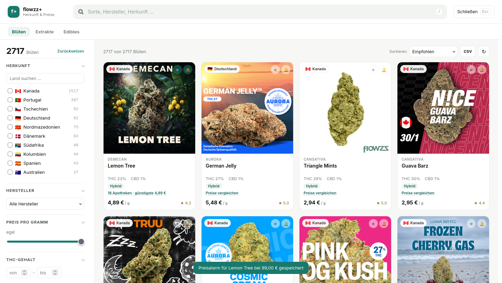
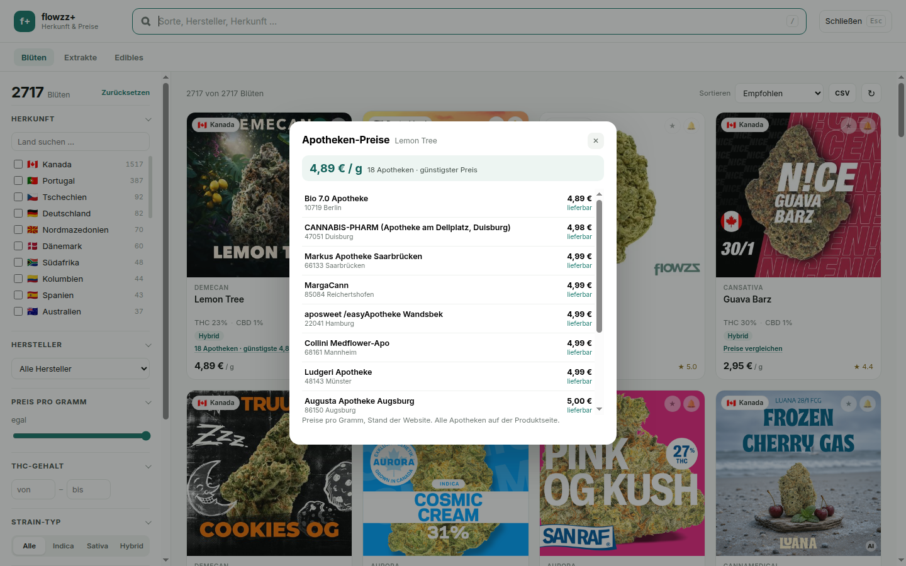

# flowzz+ · Herkunft, Preise & Suche

Inoffizielle Userscript-/Erweiterungs-Sammlung für [flowzz.com](https://flowzz.com):
Herkunftsfilter, Volltextsuche, Apotheken-Preisvergleich, Favoriten, Preisalarm und CSV-Export –
für **Blüten, Extrakte und Edibles**.



## Installation (Tampermonkey, empfohlen)

1. [Tampermonkey](https://www.tampermonkey.net/) installieren (Firefox, Chrome, Edge, Safari).
2. Diesen Link öffnen:
   **https://github.com/CRZX1337/flowzz-plus/releases/latest/download/flowzz-plus.user.js**
3. Im Tampermonkey-Dialog auf **Installieren** klicken.
4. flowzz.com neu laden – unten rechts erscheint **„Herkunft filtern“** (oder `/` drücken).

**Auto-Update:** Das Script trägt `@updateURL` und `@downloadURL` auf das jeweils neueste
Release. Tampermonkey prüft automatisch (Standard: täglich) und aktualisiert; manuell im
Dashboard unter *Einstellungen → Updates prüfen*. Wichtig: über den Link installieren, nicht
die Datei herunterladen und hineinziehen – sonst fehlt die Update-URL.

## Als Erweiterung

**Firefox:** `flowzz-plus-firefox.xpi` aus dem [neuesten Release](../../releases/latest)
herunterladen und unter `about:debugging#/runtime/this-firefox` → *Temporäres Add-on laden*
auswählen. Läuft bis zum Neustart; dauerhaft erst nach Signatur (AMO unlisted).
Der Preisalarm mit Hintergrundprüfung läuft nur hier, nicht im Userscript.

**Chrome/Edge:** `flowzz-plus-chrome.zip` entpacken, `chrome://extensions` → Entwicklermodus →
*Entpackte Erweiterung laden*.

## Funktionen

- **Herkunft** – alle Länder mit Flagge und Trefferzahl, Mehrfachauswahl
- **Suche** über Sorte, Produktname, Hersteller und Herkunft
- **Filter** – Preis pro Gramm, THC von/bis, Strain-Typ, Hersteller, Bestrahlung,
  nur lieferbar, nur Favoriten
- **Kategorien** – Blüten (2.717), Extrakte (209), Edibles
- **Apotheken-Preisvergleich** pro Produkt mit Preis, PLZ/Ort, Verfügbarkeit
- **Favoriten** und **Preisalarm** (Zielpreis, Prüfung alle 3 h, Benachrichtigung)
- **CSV-Export** der aktuellen Auswahl
- **Teilbare Links**, z. B. `?fx=1&origin=Kanada&thc=25-&price=6&cat=flowers`



## Entwicklung

```bash
npm run check   # Syntax von content.js und background.js
npm run build   # erzeugt dist/ (userscript, chrome.zip, firefox.xpi, updates.json)
```

Quellen liegen in `src/`, Icons in `icons/`. Der Build inlined das CSS in das Userscript und
setzt Version + Update-URLs.

### Release

1. Version in `package.json` erhöhen (z. B. `1.2.0`).
2. Committen und Tag setzen: `git tag v1.2.0 && git push origin v1.2.0`.
3. GitHub Actions baut und veröffentlicht das Release mit allen Artefakten.
   Tampermonkey zieht das Update über `releases/latest/download/flowzz-plus.user.js`.

## Berechtigungen (Erweiterung)

`storage` (Cache/Favoriten/Alarme), `alarms` (3-stündige Preisprüfung),
`notifications` (Preisalarm), `activeTab` (Toolbar-Klick), Host nur `https://flowzz.com/*`.

## Grenzen

- Apothekenpreise werden pro Produkt geladen (die API liefert max. ~3 Produkte pro Anfrage
  und drosselt); die Karte zeigt den Listenpreis, die Apothekenliste öffnet sich auf Klick.
- Edibles listet die API derzeit nur mit drei verfügbaren Produkten.
- Die Daten gehören flowzz.com; dieses Projekt zeigt sie nur anders an.

## Lizenz

MIT – siehe [LICENSE](LICENSE). Kein offizielles Angebot von flowzz.com.
